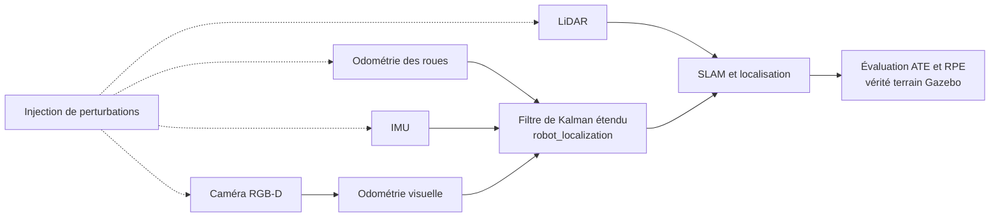

# Fusion de capteurs et robustesse d'un robot mobile

> **État : en préparation, démarrage en novembre 2026.** Aucun code ni résultat n'est encore publié. Ce document décrit l'objectif et le protocole, et les tableaux seront remplis avec les mesures réelles.

Ce projet ajoute une fusion roues, IMU, caméra et LiDAR au TurtleBot3 simulé de [robot-mobile](https://github.com/essomanam/robot-mobile). Il mesure ensuite ce que chaque capteur apporte quand les conditions se dégradent.

Une localisation peut sembler excellente dans une simulation propre. Ce travail cherche donc à savoir où elle casse, et si la fusion retarde vraiment la panne.

## Question de recherche

Quel capteur apporte le plus de robustesse à la localisation, face au bruit, à une faible lumière ou à la perte temporaire d'un capteur ?

## Architecture prévue

## Technologies

| Domaine | Choix |
|---|---|
| Environnement | Ubuntu 26.04, ROS 2 Lyrical, Gazebo Jetty, comme `robot-mobile` |
| Fusion | `robot_localization`, à confirmer sous Lyrical |
| SLAM | RTAB-Map, slam_toolbox |
| Évaluation | Outils de `robot_mobile_evaluation`, Python |

## Protocole d'évaluation

**Configurations testées**

| Code | Capteurs |
|---|---|
| F0 | Roues seules |
| F1 | Roues et IMU |
| F2 | Roues, IMU et odométrie visuelle |
| F3 | RTAB-Map avec roues, caméra RGB-D et LiDAR |

**Perturbations testées**

| Code | Condition |
|---|---|
| P0 | Conditions nominales |
| P1 | Bruit renforcé sur les roues et l'IMU |
| P2 | Faible lumière et textures pauvres |
| P3 | Caméra coupée pendant 10 s |
| P4 | LiDAR coupé pendant 10 s |

Chaque couple configuration et perturbation sera répété au moins 5 fois, sur le même parcours et avec des graines publiées. Les résultats incluront des intervalles de confiance, ainsi que les décrochages et leur durée.

## Résultats

| Mesure | F0 | F1 | F2 | F3 |
|---|---|---|---|---|
| ATE RMSE, P0 (m) | à mesurer | à mesurer | à mesurer | à mesurer |
| RPE, P0 | à mesurer | à mesurer | à mesurer | à mesurer |
| ATE RMSE, P1 (m) | à mesurer | à mesurer | à mesurer | à mesurer |
| ATE RMSE, P2 (m) | à mesurer | à mesurer | à mesurer | à mesurer |
| Temps de récupération, P3 (s) | à mesurer | à mesurer | à mesurer | à mesurer |
| Temps de récupération, P4 (s) | à mesurer | à mesurer | à mesurer | à mesurer |

## Feuille de route

- [ ] Vérifier `robot_localization` sous Lyrical, ou choisir une alternative
- [ ] Réutiliser la simulation et les parcours de `robot-mobile`
- [ ] Configurer F0, F1 et F2 et justifier les covariances
- [ ] Mesurer la référence F3
- [ ] Écrire l'injecteur de perturbations
- [ ] Automatiser la campagne complète
- [ ] Publier les courbes d'erreur, les limites et une courte vidéo
- [ ] Rejouer une partie du protocole sur un rosbag réel si le robot est disponible

## Limites attendues

Le bruit de Gazebo reste un modèle simplifié, donc les conclusions ne se transposeront pas directement à un vrai robot. La vérité terrain n'existe aussi qu'en simulation, et un essai réel demandera une autre référence de position.

## Lancer le projet

Les instructions d'installation arriveront avec le premier code exécutable.

## Projets liés

- [robot-mobile](https://github.com/essomanam/robot-mobile) : simulation, parcours et outils d'évaluation.

## Auteur

Esso-Manam MANGANMANA, M2 Robotique et Systèmes Autonomes, UTBM.
[Portfolio](https://essomanam.github.io) · [LinkedIn](https://www.linkedin.com/in/essomanam-manganmana)

## Licence

MIT, voir [LICENSE](LICENSE). Les éléments repris de `robot-mobile` restent sous licence Apache-2.0.
